# Architecture & Engineering Specifications: Enterprise RAG

## 1. System Overview

This architecture implements a high-throughput, low-latency, enterprise-grade Retrieval-Augmented Generation (RAG) platform on AWS. The design decouples document ingestion from low-latency query serving and ensures **zero public internet exposure** for all AI, vector storage, and caching layers.

```mermaid
flowchart TD
    subgraph IngestionPlane["Ingestion Plane (Asynchronous)"]
        S3["S3 Document Bucket\n(KMS CMK Encrypted)"] -->|Object Created| EB["Amazon EventBridge"]
        EB -->|Trigger| SFN["AWS Step Functions\nState Machine"]
        SFN --> S1["1. Text Extraction\n(PDF/Text/Markdown)"]
        S1 --> S2["2. PII Redaction\n(Amazon Comprehend + Regex)"]
        S2 --> S3["3. Semantic Chunking\n(Structure & Overlap Aware)"]
        S3 --> S4["4. Embedding Generation\n(Bedrock Titan Text v2)"]
        S4 --> S5["5. Vector DB Upsert\n(Aurora pgvector HNSW)"]
        SFN -.->|Failures| DLQ["Ingestion SQS DLQ\n(CloudWatch Alarm)"]
    end

    subgraph ServingPlane["Serving Plane (Synchronous Query Engine)"]
        Client["Client / Application"] -->|POST /query| APIGW["Amazon API Gateway\n(HTTP API / Private Link)"]
        APIGW --> QLambda["Query Lambda\n(Private Subnets)"]
        QLambda --> GR["Bedrock Guardrails\n(Prompt Injection & Topic Filter)"]
        GR --> SCache{"Redis Semantic Cache\n(Cosine Similarity >= 0.92?)"}
        SCache -->|Cache HIT <15ms| APIGW
        SCache -->|Cache MISS| Retriever["Aurora pgvector\n(HNSW Cosine Search)"]
        Retriever --> Context["Top-K Document Chunks"]
        Context --> LLM["Amazon Bedrock\n(Claude 3.5 Sonnet / Haiku)"]
        LLM --> PostGR["Output Guardrail & PII Filter"]
        PostGR --> CacheWrite["Write to Redis\n(TTL = 24h)"]
        CacheWrite --> APIGW
    end

    subgraph SecurityTier["Security & Isolation Tier"]
        VPC["Custom Multi-AZ VPC"]
        VPCE["VPC Interface Endpoints (PrivateLink)\nBedrock | Secrets | SQS | KMS | Logs"]
        KMS["KMS Customer-Managed Keys (CMKs)"]
    end
```

---

## 2. Ingestion Plane Architecture

### Asynchronous Event-Driven Decoupling
Synchronous ingestion pipelines suffer from HTTP timeouts, resource exhaustion, and vulnerability to backpressure when processing large enterprise corpora. This architecture implements an event-driven decoupled pattern:
1. **Document Landing Zone**: Documents (PDF, DOCX, TXT, Markdown, JSON) land in an S3 bucket configured with versioning, bucket policies enforcing TLS (`aws:SecureTransport = true`), and server-side encryption via AWS KMS Customer-Managed Keys (`aws:kms`).
2. **Event Dispatching**: S3 sends real-time `s3:ObjectCreated:*` notifications to Amazon EventBridge.
3. **Step Functions Orchestration**: EventBridge starts an execution of the `document-ingestion` Step Functions state machine.
4. **Resiliency & Dead Lettering**:
   - Each state features exponential backoff retries (interval 2s, backoff rate 2.0x, max attempts 3-5) targeting transient Bedrock throttling (`ThrottlingException`, `ProvisionedThroughputExceededException`).
   - Terminal errors across any step are captured by catch handlers and routed to an encrypted SQS Dead Letter Queue (DLQ).
   - CloudWatch metric alarms trigger immediate notifications when DLQ visibility count exceeds zero.

### Ingestion Stages
- **Text Extraction**: Uses `pypdf` with UTF-8 normalization, extracting text alongside structural page metadata and S3 URI provenance.
- **PII Detection & Redaction**: Two-tier sanitization:
  1. High-speed regex pass for structured high-risk tokens: SSN (`\d{3}-\d{2}-\d{4}`), Credit Cards (Luhn compatible patterns), AWS IAM Access Keys (`(AKIA|ABIA|ACCA|ASIA)...`), emails, and phone numbers.
  2. Amazon Comprehend contextual PII detection (`detect_pii_entities`) masking names, physical addresses, and banking credentials.
- **Semantic & Structural Chunking**:
  - Respects natural paragraph and sentence boundaries rather than arbitrary character splits.
  - Maintains configurable overlap window (`chunk_overlap=200`) to guarantee context retention across chunk boundaries.
  - Generates deterministic, content-addressable UUID5 chunk identifiers.
- **Embedding Generation**: Amazon Bedrock Titan Text Embeddings v2 (`amazon.titan-embed-text-v2:0`):
  - 1024-dimension normalized float32 vectors.
  - Normalized vectors allow cosine distance to be computed via inner product or cosine distance operators.
- **Aurora PostgreSQL pgvector Storage**:
  - Atomically writes document metadata into `documents` table.
  - Upserts vector chunks into `document_chunks` table within a single transaction.

---

## 3. Storage & Retrieval: Aurora PostgreSQL (pgvector)

### Why Aurora PostgreSQL Serverless v2 over OpenSearch Serverless?
| Evaluation Criteria | Amazon Aurora PostgreSQL (pgvector) | Amazon OpenSearch Serverless (AOSS) |
| :--- | :--- | :--- |
| **Minimum Baseline Cost** | 0.5 ACU (~$43/month) | 4 OCUs (~$700/month minimum) |
| **Transactional Consistency** | Full ACID transactions | Eventual consistency |
| **Relational Metadata Filtering** | Rich SQL joins, foreign keys, JSONB GIN indexes | Limited Lucene filter queries |
| **Scaling Granularity** | Seamless 0.5 ACU increments | Fixed 2-4 OCU increments |
| **Network Isolation** | Isolated database subnets (no internet route) | VPC endpoint with access policies |

### Indexing Strategy: HNSW with Cosine Distance
- **Algorithm**: Hierarchical Navigable Small World (`HNSW`).
- **Operator**: `vector_cosine_ops` using the `<=>` cosine distance operator.
- **Index Parameters**:
  - `m = 16`: Number of bidirectional links per vector node.
  - `ef_construction = 64`: Size of the dynamic candidate list during index build, maximizing recall at minimal memory overhead.

---

## 4. Semantic Caching Engine (Amazon ElastiCache Redis)

### Mathematical Foundations
Semantic caching reduces LLM generation costs and query latencies by matching semantically equivalent questions (e.g., *"How do I enable KMS encryption on S3?"* vs *"What is the procedure for encrypting an S3 bucket with customer-managed keys?"*).

Given incoming query vector $\mathbf{q} \in \mathbb{R}^{d}$ and cached query vector $\mathbf{c} \in \mathbb{R}^{d}$:
$$\text{Cosine Similarity}(\mathbf{q}, \mathbf{c}) = \frac{\mathbf{q} \cdot \mathbf{c}}{\|\mathbf{q}\| \|\mathbf{c}\|}$$

Since Bedrock Titan Text v2 vectors are $L_2$-normalized during inference ($\|\mathbf{q}\| = \|\mathbf{c}\| = 1$), cosine similarity simplifies to the Euclidean inner product:
$$\text{Cosine Similarity}(\mathbf{q}, \mathbf{c}) = \sum_{i=1}^{d} q_i \cdot c_i$$

### Dual-Path Lookup Strategy
1. **Tier 1 (Exact Match)**:
   - SHA-256 hash of normalized query string: $O(1)$ key lookup in `rag:cache:exact:<hash>`.
   - Latency: **< 1.0 ms**.
2. **Tier 2 (Vector Semantic Search)**:
   - Scans indexed candidate vectors in `rag:cache:entry:*`.
   - Computes vectorized cosine similarity using BLAS-accelerated NumPy dot products.
   - Evaluates condition: $\text{Cosine Similarity} \ge \tau$ (where $\tau = 0.92$ by default).
   - Latency: **< 15.0 ms**.
3. **Cache Invalidation & TTL**:
   - Each cached entry is assigned an enterprise TTL (default 86,400s / 24 hours).
   - Background sweeping of expired set pointers prevents memory bloat.

---

## 5. Security, Governance & Zero-Trust Architecture

### Zero Public Internet Exposure (VPC Architecture)
- Backend resources reside across **3 Availability Zones** in **Isolated Database Subnets** (Aurora, ElastiCache) and **Private Application Subnets** (Lambda).
- All outbound communication to AWS services routes through **AWS PrivateLink VPC Interface Endpoints**:
  - `bedrock-runtime` & `bedrock`
  - `secretsmanager`
  - `comprehend`
  - `logs` & `monitoring` (CloudWatch)
  - `states` (AWS Step Functions)
  - `sqs`
  - `kms`
  - `s3` (Gateway Endpoint with prefix list route)
- Security groups strictly follow least-privilege:
  - Aurora PostgreSQL accepts port 5432 ingress **only** from the Lambda Security Group.
  - ElastiCache Redis accepts port 6379 ingress **only** from the Lambda Security Group.
  - VPC Endpoints accept port 443 ingress **only** from the Lambda Security Group.

### Amazon Bedrock Guardrails
Configured via Terraform `aws_bedrock_guardrail`:
1. **Prompt Injection Defense**: Content policy filters set to `HIGH` for `PROMPT_ATTACK`. Protects against prompt leakage, system prompt overrides, and delimiter manipulation.
2. **Content Safety**: Filters for `SEXUAL`, `VIOLENCE`, `HATE`, `INSULTS`, and `MISCONDUCT` set to `HIGH`.
3. **Sensitive Information Policy**:
   - Blocks: `US_SOCIAL_SECURITY_NUMBER`, `CREDIT_DEBIT_CARD_NUMBER`, `US_BANK_ACCOUNT_NUMBER`, `AWS_ACCESS_KEY`, `PASSWORD`.
   - Anonymizes: `EMAIL`, `PHONE`.
4. **Contextual Grounding**:
   - `GROUNDING` threshold set to `0.70` to block ungrounded hallucinated statements.
   - `RELEVANCE` threshold set to `0.70` to ensure answers strictly address the user inquiry.
